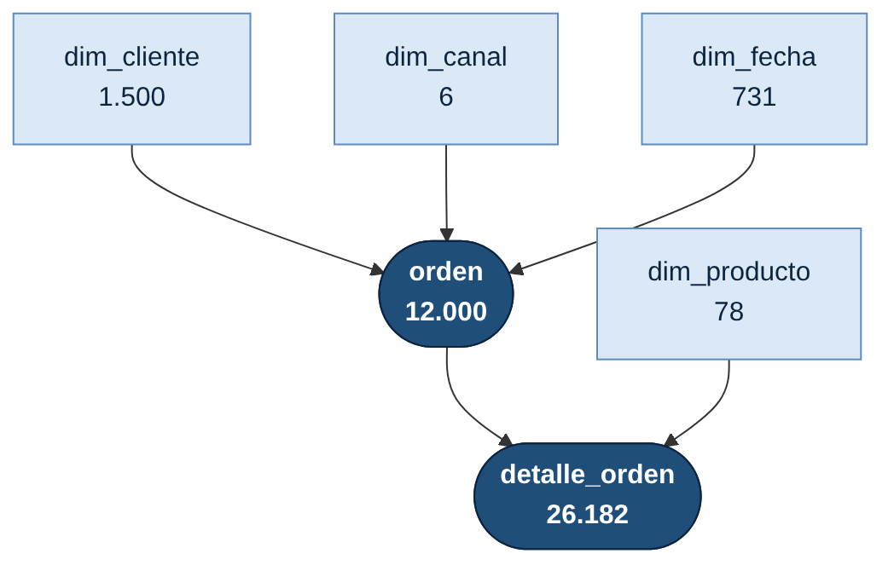
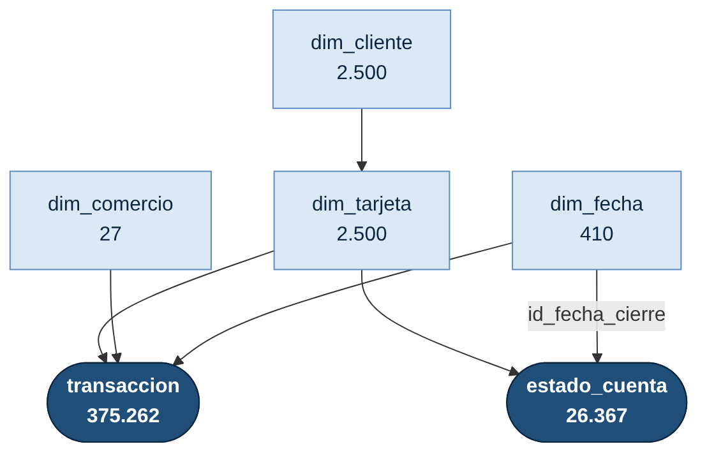
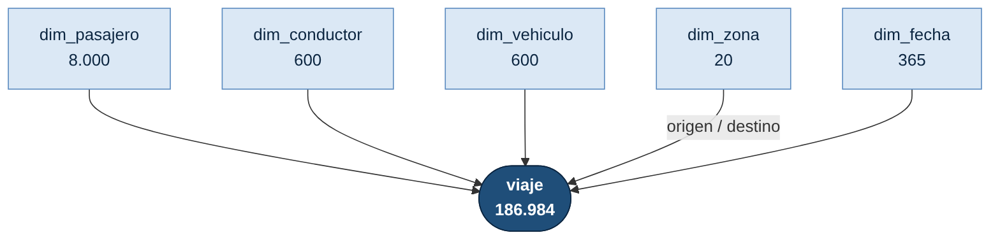

# Esquema de datos: bases relacionales

Tres bases de datos **sintéticas** con modelo dimensional (esquema estrella), pensadas para practicar **SQL**, **Power BI** y análisis con **pandas**. Las tres son independientes entre sí, pero siguen las mismas convenciones de diseño, así que lo que se aprende en una sirve para las otras.

| Base | Dominio | Período | Tablas | Filas | Hechos | Preguntas típicas |
|---|---|---|---:|---:|---|---|
| [**compras**](compras/) | Retail omnicanal | 2024–2025 | 6 | 40.497 | `orden`, `detalle_orden` | ventas, margen, ticket promedio, YoY, canales |
| [**tarjetas_credito**](tarjetas_credito/) | Emisor de tarjetas de crédito | 2025 | 6 | 407.066 | `transaccion`, `estado_cuenta` | mora, roll rates, utilización de cupo, fraude |
| [**taxis**](taxis/) | Transporte de pasajeros en Santiago | 2025 | 6 | 196.569 | `viaje` | demanda por hora, precio dinámico, cancelaciones, rutas |

## Cómo se organizan los datos

Son **tres bases independientes**: no comparten tablas ni se relacionan entre sí. Cada una es una estrella propia, donde las **tablas de hechos** (en azul oscuro) guardan eventos medibles y las **dimensiones** (en celeste) los describen. Cada base trae su propia `dim_fecha`, que cubre solo su período.

### 🛒 compras



Una **orden** la hace un cliente, por un canal, en una fecha. Cada orden tiene una o más líneas en **detalle_orden**, una por producto.

### 💳 tarjetas_credito



Cada cliente tiene una **tarjeta**. La tarjeta genera **transacciones** (compras en comercios, avances, pagos e intereses) y un **estado de cuenta** al cierre de cada mes.

### 🚕 taxis



Cada **viaje** une a un pasajero con un conductor y su vehículo, entre una zona de origen y una de destino, en una fecha.

### Convenciones comunes

| Convención | Regla |
|---|---|
| Prefijos | `dim_` para dimensiones. Los hechos van sin prefijo |
| Llaves primarias | `id_<entidad>`, entero correlativo desde 1 |
| Llaves foráneas | mismo nombre que la PK a la que apuntan, con dos excepciones: `id_zona_origen`/`id_zona_destino` e `id_fecha_cierre` |
| Llave de fecha | `id_fecha` entero con formato `AAAAMMDD`, por ejemplo `20251225`. La estructura es igual en las tres bases, pero cada una tiene su propia tabla |
| Montos | pesos chilenos (CLP) enteros, sin decimales |
| Banderas | enteros 0/1 (`es_fin_semana`, `es_fraude`, `con_lluvia`, …) |
| Textos | en español. Los nombres de personas son ficticios |
| Vistas | `v_ventas`, `v_transacciones` y `v_viajes` dejan cada estrella aplanada para consultar rápido |

### Estructura de carpetas

```
esquema-datos/
├── README.md                    ← este archivo
├── diagramas/
│   ├── compras.png / .mmd       ← diagrama de cada base (fuente Mermaid)
│   ├── tarjetas_credito.png / .mmd
│   └── taxis.png / .mmd
├── compras/
│   ├── README.md                ← diccionario, diagrama ER y consultas
│   ├── compras.db.zip           ← base SQLite (descomprimir)
│   ├── esquema.sql              ← DDL (CREATE TABLE + vista)
│   ├── generar.py               ← script que regenera los datos
│   └── csv/                     ← una tabla por archivo (UTF-8 con BOM)
├── tarjetas_credito/            ← misma estructura (tarjetas.db.zip)
└── taxis/                       ← misma estructura (taxis.db.zip)
```

## Cómo usarlas

**SQL (SQLite):** descomprime el `.db.zip` y ábrelo con [DB Browser for SQLite](https://sqlitebrowser.org/) o DBeaver. Para PostgreSQL o SQL Server, ejecuta `esquema.sql` y carga los CSV.

**Power BI:** usa *Obtener datos → Texto/CSV* con cada archivo de `csv/`, o *Carpeta* para cargarlos todos a la vez. Luego crea las relaciones que muestra el diagrama ER de cada README y marca `dim_fecha` como tabla de fechas.

**Python:**

```python
import pandas as pd, sqlite3

# Directo desde GitHub
base = "https://raw.githubusercontent.com/fmansillaib/umayor_class/main/datasets/esquema-datos"
viajes = pd.read_csv(f"{base}/taxis/csv/viaje.csv")

# Con SQL sobre la base local
con = sqlite3.connect("compras.db")
pd.read_sql("SELECT anio, SUM(monto_neto) AS ventas FROM v_ventas GROUP BY anio", con)
```

**Regenerar o ampliar:** cada `generar.py` usa una semilla fija, así que produce siempre los mismos datos. Para crear más volumen, cambia los parámetros del script (número de clientes, órdenes, etc.) y ejecútalo con `python generar.py` dentro de la carpeta.

## Nota

Todos los datos son **sintéticos**: se generaron con reglas de negocio simplificadas y no corresponden a personas, empresas ni transacciones reales. Los patrones de cada README (estacionalidad, mora por segmento, precio dinámico) son intencionales, para que el análisis encuentre algo.
