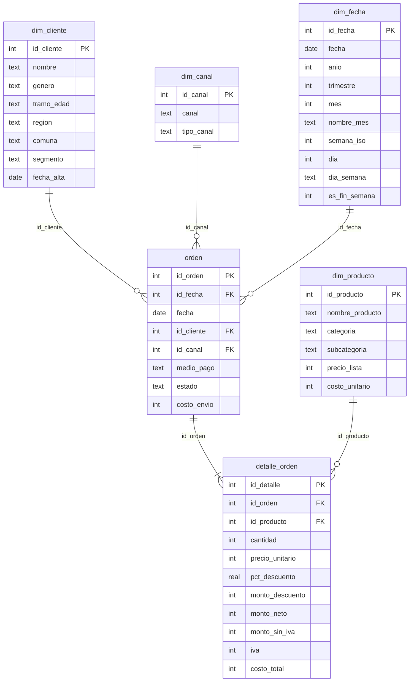

# Compras (retail)

Base sintética de ventas de un retailer chileno con canales online y presenciales. Cubre **2024–2025**, con montos en **CLP** e IVA de 19%.

| Tabla | Tipo | Filas | Grano (una fila por…) |
|---|---|---:|---|
| `orden` | Hecho | 12.000 | orden de compra |
| `detalle_orden` | Hecho | 26.182 | línea de producto dentro de una orden |
| `dim_cliente` | Dimensión | 1.500 | cliente |
| `dim_producto` | Dimensión | 78 | producto |
| `dim_canal` | Dimensión | 6 | canal de venta |
| `dim_fecha` | Dimensión | 731 | día (2024-01-01 a 2025-12-31) |

Además trae la vista `v_ventas`, que une todas las tablas al grano de `detalle_orden` y ya calcula el margen.

## Modelo de datos



## Diccionario de campos clave

| Campo | Definición |
|---|---|
| `orden.estado` | `Completada` (93%), `Devuelta` (4%) o `Anulada` (3%) |
| `orden.medio_pago` | Tarjeta de crédito, tarjeta de débito, transferencia o efectivo (este último solo en tiendas) |
| `detalle_orden.monto_neto` | `cantidad × precio_unitario − monto_descuento`, con IVA incluido |
| `detalle_orden.monto_sin_iva` | `monto_neto / 1,19` |
| `detalle_orden.costo_total` | `cantidad × costo_unitario` |
| margen (en la vista) | `monto_sin_iva − costo_total` |
| `dim_cliente.segmento` | `Nuevo`, `Frecuente` o `Premium`. Un cliente Premium compra unas 5 veces más que uno Nuevo |
| `dim_canal.tipo_canal` | `Online` (Web, App, Marketplace) o `Presencial` (3 tiendas) |

## Patrones incluidos

- **Estacionalidad:** noviembre pesa ×1,3 y diciembre ×1,8. Los fines de semana suman un 20% más.
- **Crecimiento:** 2025 vende un 15% más que 2024. Las ventas completadas suman unos $2.356 millones en 2024 y $2.658 millones en 2025.
- **Descuentos:** son más frecuentes en noviembre y diciembre.
- **Geografía:** el 55% de los clientes vive en la Región Metropolitana.

## Consultas de ejemplo

```sql
-- Ventas y margen por año y categoría (solo órdenes completadas)
SELECT anio, categoria, SUM(monto_neto) AS ventas, SUM(margen) AS margen,
       ROUND(100.0 * SUM(margen) / SUM(monto_sin_iva), 1) AS margen_pct
FROM v_ventas WHERE estado = 'Completada'
GROUP BY anio, categoria ORDER BY anio, ventas DESC;

-- Ticket promedio por canal
SELECT ca.canal, COUNT(DISTINCT o.id_orden) AS ordenes,
       SUM(d.monto_neto) / COUNT(DISTINCT o.id_orden) AS ticket_promedio
FROM orden o JOIN detalle_orden d USING(id_orden) JOIN dim_canal ca USING(id_canal)
WHERE o.estado = 'Completada' GROUP BY ca.canal;
```

```DAX
Ventas      = CALCULATE ( SUM ( detalle_orden[monto_neto] ), orden[estado] = "Completada" )
Ticket Prom = DIVIDE ( [Ventas], CALCULATE ( DISTINCTCOUNT ( orden[id_orden] ), orden[estado] = "Completada" ) )
Ventas YoY  = DIVIDE ( [Ventas] - CALCULATE ( [Ventas], SAMEPERIODLASTYEAR ( dim_fecha[fecha] ) ),
                       CALCULATE ( [Ventas], SAMEPERIODLASTYEAR ( dim_fecha[fecha] ) ) )
```

> **Power BI:** relaciona `detalle_orden` con `dim_producto` y con `orden`, y luego `orden` con `dim_cliente`, `dim_canal` y `dim_fecha`. Marca `dim_fecha` como tabla de fechas.
