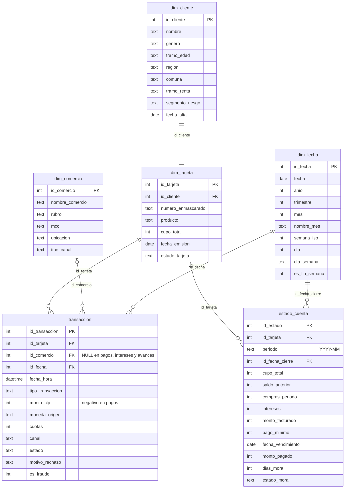

# Tarjetas de crédito

Base sintética de un emisor de tarjetas de crédito: transacciones, estados de cuenta mensuales, pagos, intereses y mora. Cubre **todo 2025**, con montos en **CLP**.

| Tabla | Tipo | Filas | Grano (una fila por…) |
|---|---|---:|---|
| `transaccion` | Hecho | 375.262 | movimiento: compra, avance, pago o interés |
| `estado_cuenta` | Hecho | 26.367 | tarjeta × mes de facturación |
| `dim_cliente` | Dimensión | 2.500 | cliente |
| `dim_tarjeta` | Dimensión | 2.500 | tarjeta (una por cliente) |
| `dim_comercio` | Dimensión | 27 | comercio |
| `dim_fecha` | Dimensión | 410 | día (2025-01-01 a 2026-02-14, para cubrir los vencimientos de diciembre) |

Además trae la vista `v_transacciones`, que une la transacción con la tarjeta, el cliente, el comercio y la fecha.

## Modelo de datos



## Diccionario de campos clave

| Campo | Definición |
|---|---|
| `transaccion.tipo_transaccion` | `Compra`, `Avance en efectivo`, `Pago` o `Interés` |
| `transaccion.estado` | `Aprobada` o `Rechazada`. Un 3,8% de las compras se rechaza |
| `transaccion.motivo_rechazo` | Cupo insuficiente, sospecha de fraude, clave incorrecta o error de comunicación |
| `transaccion.es_fraude` | 1 si la transacción es fraudulenta (≈0,4%) |
| `transaccion.cuotas` | 1, 3, 6 o 12. Solo hay cuotas en rubros de bienes durables y en compras sobre $50.000 |
| `estado_cuenta.monto_facturado` | `saldo_anterior + compras_periodo + intereses` |
| `estado_cuenta.pago_minimo` | el mayor entre 5% del facturado y $10.000 (o el facturado, si es menor) |
| `estado_cuenta.intereses` | 2,4% mensual sobre el saldo anterior no pagado |
| `estado_cuenta.dias_mora` | suma 30 por cada mes en que se paga menos que el mínimo y vuelve a 0 al pagar el mínimo |
| `estado_cuenta.estado_mora` | `Al día`, `Mora 1-30`, `Mora 31-60`, `Mora 61-90` o `Mora +90` |
| `dim_cliente.segmento_riesgo` | `A` (bajo) a `D` (alto). Define la probabilidad de pagar el total, el mínimo, un pago parcial o no pagar |
| `dim_tarjeta.producto` | Clásica, Gold, Platinum o Black, según el tramo de renta |
| `dim_tarjeta.estado_tarjeta` | `Activa`, `Inactiva` (sin uso) o `Bloqueada por mora` (tras llegar a 90 días) |

## Patrones incluidos

**Mora a diciembre de 2025, por segmento:**

| Segmento | Mora > 0 | Mora +90 |
|---|---:|---:|
| A | 3,7% | 0,0% |
| B | 11,5% | 0,3% |
| C | 34,9% | 8,0% |
| D | 57,3% | 23,4% |

- **Uso del cupo:** la utilización promedio está en torno a 65%. Los avances en efectivo son más frecuentes en los segmentos C y D.
- **Fraude:** se concentra entre la 1 y las 4 de la madrugada, con montos 2 a 5 veces mayores que lo habitual. Un 55% de los casos se rechaza.
- **Estacionalidad:** el gasto sube en septiembre (Fiestas Patrias, ×1,15) y en diciembre (×1,45).
- **Comercios extranjeros:** las suscripciones digitales y las aerolíneas extranjeras se marcan con `moneda_origen = 'USD'`, aunque el monto se registra en CLP.

## Consultas de ejemplo

```sql
-- Matriz de transición de mora (roll rate) entre noviembre y diciembre
SELECT n.estado_mora AS nov, d.estado_mora AS dic, COUNT(*) AS tarjetas
FROM estado_cuenta n JOIN estado_cuenta d
  ON d.id_tarjeta = n.id_tarjeta AND n.periodo = '2025-11' AND d.periodo = '2025-12'
GROUP BY 1, 2 ORDER BY 1, 2;

-- Tasa de fraude por hora del día
SELECT CAST(strftime('%H', fecha_hora) AS INT) AS hora,
       ROUND(100.0 * AVG(es_fraude), 2) AS pct_fraude
FROM transaccion WHERE tipo_transaccion = 'Compra' GROUP BY hora;
```

```DAX
Compras Aprobadas = CALCULATE ( SUM ( transaccion[monto_clp] ),
                      transaccion[tipo_transaccion] = "Compra", transaccion[estado] = "Aprobada" )
Utilización Cupo  = DIVIDE ( SUM ( estado_cuenta[monto_facturado] ), SUM ( estado_cuenta[cupo_total] ) )
% Mora 30+        = DIVIDE ( CALCULATE ( COUNTROWS ( estado_cuenta ), estado_cuenta[dias_mora] >= 30 ),
                             COUNTROWS ( estado_cuenta ) )
```

> **Power BI:** relaciona `transaccion` y `estado_cuenta` con `dim_tarjeta`, y `dim_tarjeta` con `dim_cliente`. La relación de `estado_cuenta` con `dim_fecha` va por `id_fecha_cierre`.
