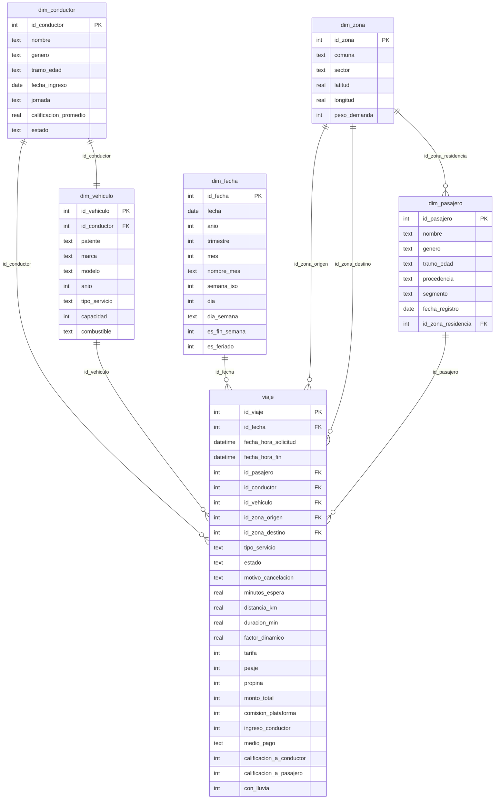

# Taxis y transporte de pasajeros

Base sintética de una plataforma de viajes en Santiago, que combina servicios de app con taxi tradicional. Cubre **todo 2025**, con montos en **CLP**.

| Tabla | Tipo | Filas | Grano (una fila por…) |
|---|---|---:|---|
| `viaje` | Hecho | 186.984 | solicitud de viaje, completada o cancelada |
| `dim_pasajero` | Dimensión | 8.000 | pasajero |
| `dim_conductor` | Dimensión | 600 | conductor |
| `dim_vehiculo` | Dimensión | 600 | vehículo (uno por conductor) |
| `dim_zona` | Dimensión | 20 | comuna de Santiago o aeropuerto, con latitud y longitud |
| `dim_fecha` | Dimensión | 365 | día de 2025, con feriados chilenos |

Además trae la vista `v_viajes`, que une todo, agrega la hora de solicitud y los nombres de las comunas de origen y destino.

## Modelo de datos



## Diccionario de campos clave

| Campo | Definición |
|---|---|
| `viaje.estado` | `Completado` (90%), `Cancelado por pasajero` (6,5%) o `Cancelado por conductor` (3%) |
| `viaje.tipo_servicio` | Básico, Confort, XL o Taxi tradicional |
| `viaje.tarifa` | `(base + $/km × km + $/min × min) × factor_dinamico`, con una tarifa mínima por servicio |
| `viaje.factor_dinamico` | 1,0 base. Sube en horas punta, con lluvia y en la madrugada de fin de semana. El taxi tradicional siempre usa 1,0 |
| `viaje.monto_total` | `tarifa + peaje + propina` |
| `viaje.comision_plataforma` | 25% de la tarifa, o 15% en el taxi tradicional |
| `viaje.ingreso_conductor` | `monto_total − comision_plataforma` |
| `viaje.calificacion_*` | de 1 a 5. Queda en NULL si no se calificó o si el viaje se canceló |
| Cancelaciones | km, minutos y propina quedan en 0. Un 30% de las cancelaciones del pasajero cobra $1.500 |

**Tarifas por servicio:**

| Servicio | Base | $/km | $/min | Mínima |
|---|---:|---:|---:|---:|
| Básico | 700 | 520 | 110 | 2.500 |
| Confort | 900 | 680 | 140 | 3.500 |
| XL | 1.200 | 820 | 160 | 4.500 |
| Taxi tradicional | 500 | 550 | 110 | 2.000 |

## Patrones incluidos

- **Horas punta:** en días hábiles, de 7 a 9 y de 18 a 20 horas. Los fines de semana la demanda sube de noche.
- **Lluvia:** cae sobre todo entre mayo y agosto. Esos días hay un 25% más de demanda, el factor dinámico promedio pasa de 1,07 a 1,40 y la espera de 6 a 8 minutos.
- **Cancelaciones:** aumentan cuando la espera supera los 9 minutos.
- **Distancias:** un viaje promedio recorre unos 9 km y dura unos 25 minutos. Los destinos cercanos al origen son más probables.
- **Aeropuerto (AMB):** los viajes desde o hacia el aeropuerto siempre pagan peaje.
- **Pasajeros corporativos:** usan Confort y pagan con cuenta corporativa. En días hábiles suelen ir hacia el sector Oriente.

## Consultas de ejemplo

```sql
-- Demanda y precio por hora (días hábiles)
SELECT hora, COUNT(*) AS solicitudes, ROUND(AVG(factor_dinamico), 2) AS dinamica,
       ROUND(100.0 * AVG(estado <> 'Completado'), 1) AS pct_cancelado
FROM v_viajes WHERE es_fin_semana = 0 AND es_feriado = 0
GROUP BY hora ORDER BY hora;

-- Ranking de conductores por ingreso
SELECT c.nombre, COUNT(*) AS viajes, SUM(v.ingreso_conductor) AS ingreso,
       ROUND(AVG(v.calificacion_a_conductor), 2) AS rating
FROM viaje v JOIN dim_conductor c USING(id_conductor)
WHERE v.estado = 'Completado' GROUP BY c.nombre ORDER BY ingreso DESC LIMIT 10;
```

```DAX
Viajes Completados = CALCULATE ( COUNTROWS ( viaje ), viaje[estado] = "Completado" )
% Cancelación      = 1 - DIVIDE ( [Viajes Completados], COUNTROWS ( viaje ) )
Ventas por Destino = CALCULATE ( SUM ( viaje[monto_total] ),
                       USERELATIONSHIP ( viaje[id_zona_destino], dim_zona[id_zona] ) )
```

> **Power BI:** `viaje` se relaciona dos veces con `dim_zona`. Deja activa la relación por `id_zona_origen` e inactiva la de `id_zona_destino`, y actívala con `USERELATIONSHIP` cuando la necesites. Asigna a las columnas `latitud` y `longitud` la categoría de datos geográficos para usarlas en mapas.
